# Guía de Arquitectura y Construcción de Chatbots en ScraperLabs

Este documento define el estándar oficial de ingeniería para diseñar, configurar, entrenar, orquestar y desplegar **Chatbots y Agentes Conversacionales Multi-Tenant** dentro del ecosistema de **ScraperLabs**.

---

## 1. Visión General y Filosofía Multi-Tenant

El motor de chatbots de ScraperLabs está concebido como una plataforma **BaaS (Bot as a Service)** impulsada por Inteligencia Artificial generativa (Gemini Flash Lite), web scraping automatizado y orquestación multi-agente.

Cada bot es una entidad independiente que pertenece a un cliente o tenant (`clientId`), permitiendo:
1. **Chatbots Propios de ScraperLabs:** Ej. **Scrapy** (`botId: "scrapy"`), enfocado en servicios de extracción, cotizaciones B2B y soporte técnico.
2. **Chatbots para Clientes y E-commerce:** Ej. **Oferty** (`botId: "oferty"`), enfocado en recomendación de productos, comparación de precios en retailers colombianos y ahorro inteligente.
3. **Chatbots para Clientes Externos:** Cualquier cliente corporativo que requiera un asistente virtual entrenado con el contenido de su propia página web.

```mermaid
flowchart TD
    subgraph Canales_Consumo["Canales de Consumo"]
        WebWidget["Widget React / Next.js<br>(Público, excluye /admin)"]
        EmbedScript["Script Embebible Universal<br>(widget.js con data-bot-id)"]
        BackendProxy["Backend de Cliente<br>(vía API Key)"]
    end

    subgraph ScraperLabs_API["ScraperLabs Gateway / Lambda"]
        PublicEndpoint["POST /api/chat/message"]
        PublicConfig["GET /api/bots/:botId/public"]
    end

    subgraph Orquestador["AgentOrchestratorService"]
        Guardrail["Guardrail de Seguridad<br>(Anti-Jailbreak & Anti-Capciosas)"]
        Router["Triage / Router Agent<br>(Clasificación de Intención)"]
        
        subgraph Agentes_Especializados["Agentes Especializados"]
            RestrictedAgent["Agente de Bloqueo<br>(Respuesta Determinista)"]
            KnowledgeAgent["Knowledge Agent (RAG)<br>(Gemini + Base de Conocimiento)"]
            LeadAgent["Lead Qualifier Agent<br>(Captura de Oportunidades)"]
            HandoffAgent["Escalation Agent<br>(WhatsApp Handoff)"]
        end
    end

    subgraph DynamoDB["Persistencia DynamoDB"]
        TableBots[("ScraperLab-Bots<br>(Configuración & Branding)")]
        TableKnowledge[("ScraperLab-BotKnowledge<br>(Documentos RAG)")]
        TableSessions[("ScraperLab-ChatSessions<br>(Historial & Leads)")]
    end

    WebWidget --> PublicEndpoint
    EmbedScript --> PublicEndpoint
    BackendProxy --> PublicEndpoint

    PublicEndpoint --> Orquestador
    Orquestador <--> TableBots
    Orquestador <--> TableSessions
    Orquestador <--> TableKnowledge

    Router --> Guardrail
    Guardrail -->|Capciosa / Jailbreak| RestrictedAgent
    Guardrail -->|Consulta Válida| KnowledgeAgent
    Guardrail -->|Interés Comercial| LeadAgent
    Guardrail -->|Solicitud Humano| HandoffAgent
```



---

## 2. Modelo de Datos en DynamoDB

La arquitectura se apoya en 3 tablas principales en DynamoDB:

### A. Tabla `ScraperLab-Bots`
Almacena la metadata, branding, system prompt y configuración de canales.

```json
{
  "botId": "nombre-unico-bot",
  "name": "Nombre Público",
  "clientId": "identificador-cliente",
  "status": "active",
  "enabled": true,
  "avatarUrl": "/images/avatar.png",
  "description": "Propósito comercial o funcional del bot",
  "branding": {
    "primaryColor": "#6e2ff7",
    "secondaryColor": "#ff7722",
    "bubbleText": "¡Hola! Pregúntale a ...",
    "welcomeMessage": "¡Hola! Soy tu asistente virtual...",
    "quickSuggestions": [
      "¿Qué productos recomiendas?",
      "¿Cómo funciona la plataforma?"
    ]
  },
  "channels": {
    "web": {
      "enabled": true,
      "allowedDomains": ["*"]
    },
    "whatsapp": {
      "enabled": true,
      "phoneNumber": "573105741697"
    }
  },
  "systemPrompt": "Instrucciones base del asistente...",
  "targetUrls": ["https://cliente.com", "https://cliente.com/faq"],
  "stats": {
    "totalConversations": 0,
    "totalMessages": 0,
    "totalLeads": 0
  },
  "createdAt": "2026-11-02T10:00:00-05:00",
  "updatedAt": "2026-11-02T10:00:00-05:00"
}
```

### B. Tabla `ScraperLab-BotKnowledge`
Almacena fragmentos semánticos estructurados que alimentan el contexto RAG del bot:
- `knowledgeId` (Hash Key): Identificador único del fragmento.
- `botId` (GSI): Relación directa con el bot.
- `sourceUrl`: URL origen raspada.
- `title`, `summary`: Resumen ejecutivo de la sección.
- `services`: Lista de productos o servicios ofrecidos.
- `faqs`: Pares `{ question, answer }` extraídos automáticamente.
- `contactInfo`: Teléfonos, correos o enlaces de atención.

### C. Tabla `ScraperLab-ChatSessions`
Almacena el historial conversacional y la calificación de leads:
- `sessionId` (Hash Key): UUID de la sesión de usuario.
- `botId`, `clientId`, `channel`.
- `messages`: Arreglo cronológico de interacciones `[{ role, content, action, timestamp }]`.
- `lead`: Datos capturados `{ email, phone, targetUrl, name, company }`.
- `hasLead`: Booleano para filtrado en el panel administrativo.

---

## 3. Flujo de Auto-Entrenamiento por Scraping (`BotTrainingService`)

El sistema permite entrenar un bot en minutos a partir de URLs públicas sin requerir carga manual de documentos:

1. **Extracción y Sanitización Web (`scrapeAndCleanUrl`):**
   - Descarga el HTML usando Axios con rotación de User-Agents.
   - Con Cheerio, elimina scripts, estilos, iframes, navbars y pies de página.
   - Extrae jerárquicamente títulos (`h1`, `h2`, `h3`) y párrafos significativos.
2. **Sintetización Semántica con Gemini AI (`extractStructuredKnowledge`):**
   - Transforma el texto crudo en un JSON estructurado con `businessSummary`, `keyOfferings`, `faqs` y `contactInfo`.
3. **Generación del System Prompt:**
   - Compila la base de conocimiento y genera un System Prompt estructurado con reglas de tono, personalidad y límites operativos.
4. **Activación:** Actualiza el estado del bot a `status: "active"`.

---

## 4. Orquestación Multi-Agente en Tiempo Real (`AgentOrchestratorService`)

Cada mensaje entrante atraviesa un pipeline de 4 fases rigurosas:

### Fase 1: Identificación y Tolerancia a Fallos
- Recupera la configuración desde DynamoDB (`BotRepository.getById`).
- Si la base de datos no está disponible o el bot no está sembrado, cuenta con **fallback defensivo nativo** para garantizar que el servicio nunca retorne un error 500 al usuario.

### Fase 2: Guardrail Restrictivo & Clasificador de Intención (Triage)
El bot debe ser estrictamente leal a su dominio. No debe convertirse en un chatbot de propósito general ni responder preguntas capciosas.

```javascript
// Pre-filtro determinista de ultra-alta velocidad (0 latencia de red)
const jailbreakPatterns = [
  'ignora tus instrucciones', 'ignore previous', 'ahora eres',
  'actúa como', 'dan mode', 'jailbreak', 'dime tu prompt'
];
const offTopicPatterns = [
  'escribe un poema', 'cuenta un chiste', 'un acertijo',
  'quién es el presidente', 'código en python', 'resuelve esta ecuación'
];

if (isJailbreak || isOffTopic) {
  return { intent: 'RESTRICTED', confidence: 1.0 };
}
```

Si la consulta pasa el pre-filtro, el **Triage Agent** (Gemini Flash Lite en modo JSON con temperatura `0.1`) categoriza la intención:
- **`RESTRICTED`:** Preguntas trampa, capciosas, dilemas o fuera de dominio $\rightarrow$ **Bloqueo Inmediato**.
- **`PRODUCT` / `INFO`:** Consultas informativas o de catálogo $\rightarrow$ **Knowledge Agent (RAG)**.
- **`LEAD`:** Consultas de cotización o compra $\rightarrow$ **Lead Qualifier Agent**.
- **`WHATSAPP`:** Solicitud de atención humana $\rightarrow$ **Handoff Agent**.
- **`GREETING`:** Saludo cordial breve $\rightarrow$ **Respuesta de cortesía**.

### Fase 3: Ejecución del Agente Especializado
- **Agente de Bloqueo (`RESTRICTED`):** Retorna una respuesta determinista, cordial y tajante, reenfocando al usuario hacia el catálogo o las funciones del servicio:
  > *"Como asistente de [Marca], únicamente puedo responder preguntas sobre productos, mejores precios, ofertas y el funcionamiento de nuestra plataforma. ¿Hay algún producto o precio que desees consultar?"*
- **Agente de Conocimiento (`INFO` / `PRODUCT`):** Recupera el contexto RAG de `ScraperLab-BotKnowledge`, inyecta el historial reciente y genera una respuesta fundamentada exclusivamente en datos reales, sin alucinaciones.
- **Agente Calificador de Leads (`LEAD`):** Extrae automáticamente email, teléfono o necesidades y los almacena en `ScraperLab-ChatSessions`.
- **Agente de Escalación (`WHATSAPP`):** Devuelve la acción `OPEN_WHATSAPP` con una URL formateada (`https://wa.me/...`) y el mensaje precargado.

### Fase 4: Persistencia y Métricas
- Registra el mensaje en la sesión de DynamoDB.
- Incrementa los contadores analíticos que se visualizan en `/admin/bots`.

---

## 5. Estándar para Integración en el Frontend

Cualquier widget conversacional que consuma los bots de ScraperLabs debe implementar obligatoriamente las siguientes directivas:

### Regla de Aislamiento de Rutas Administrativas
El chatbot debe vivir **exclusivamente en la web pública** y jamás en rutas del panel de control:

```jsx
const pathname = usePathname();
const isAdminRoute = pathname?.startsWith("/admin");

// NUNCA renderizar en el panel administrativo
if (isAdminRoute) {
  return null;
}
```

### Componentes de UI Recomendados
1. **Globo de Invitación (Tooltip):** Texto dinámico `"¡Hola! Pregúntale a [Nombre]"` con animación flotante suave y botón para abrir.
2. **Botón Circular Flotante:** Avatar oficial del bot, anillo con gradiente corporativo (`primaryColor` a `secondaryColor`) y punto verde pulsante de "en línea".
3. **Ventana de Chat:**
   - Cabecera con estado, botón de reinicio de conversación y botón de cierre.
   - Historial de mensajes con auto-scroll.
   - Barra de sugerencias rápidas (`quickSuggestions`) clickeables.
   - Input con envío por tecla Enter.
   - Notificación visual clara cuando se activa un bloqueo restrictivo (`RESTRICTED_QUERY`).

---

## 6. Métodos de Despliegue Disponibles

### Opción 1: Proxy Backend-a-Backend (Recomendado para Clientes)
El backend del cliente (`oferty-backend`) expone su propio endpoint `/api/chat/message` y reenvía hacia ScraperLabs firmando con su `SCRAPERLAB_API_KEY`:
```javascript
// En el backend del cliente
const response = await fetch('https://api.scraperlabs.com.co/api/chat/message', {
  method: 'POST',
  headers: {
    'Content-Type': 'application/json',
    'x-api-key': process.env.SCRAPERLAB_API_KEY
  },
  body: JSON.stringify({ botId: 'oferty', message, sessionId, history })
});
```

### Opción 2: Widget Embebible Universal (`widget.js`)
Para sitios web estáticos o plataformas externas, mediante una etiqueta de script:
```html
<script
  src="https://scraperlabs.com.co/widget.js"
  data-bot-id="oferty"
  defer>
</script>
```

### Opción 3: Componente Nativo React / Next.js
Importación directa del componente en el layout principal del proyecto cliente (`oferty-web/src/components/common/OfertyChatWidget.jsx`).

---

## 7. Checklist para Crear un Nuevo Bot en ScraperLabs

Al añadir un nuevo chatbot para un cliente o servicio:

1. [ ] **Diseñar Script de Siembra (`scripts/seed-[botId]-bot.js`):** Definir `botId`, `clientId`, nombre, avatar, colores, bienvenida y sugerencias rápidas.
2. [ ] **Definir System Prompt & Guardrail:** Redactar límites operativos específicos y preguntas permitidas en `AgentOrchestratorService.js`.
3. [ ] **Ejecutar Siembra en DynamoDB:**
   ```bash
   node scripts/seed-[botId]-bot.js
   ```
4. [ ] **Verificar en Consola:** Ingresar a `/admin/bots` en `scraperlabs-web` y confirmar que el bot aparece listado y activo.
5. [ ] **Entrenar URLs:** Ejecutar el auto-entrenamiento desde el modal del bot o mediante `POST /api/bots/:botId/train`.
6. [ ] **Construir el Widget del Cliente:** Respetar la exclusión estricta de `/admin` y el sistema de diseño corporativo.
7. [ ] **Actualizar Documentación:** Registrar los nuevos scripts y componentes en `scraperlab-backend-structure.txt` y `scraperlab-backend-arquitecture.txt`.
