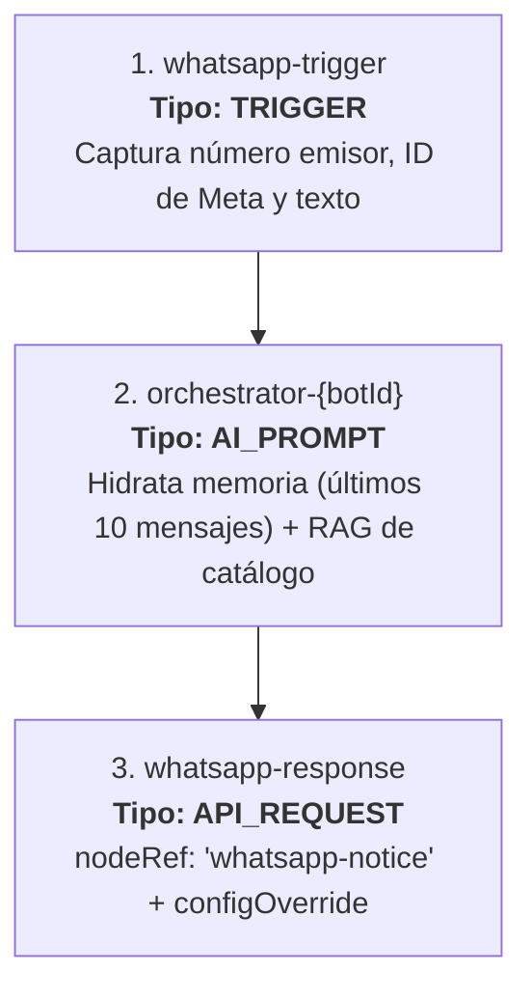

# Estándar y Patrón de Creación de Pipelines para Futuros Bots en ScraperLab

Este documento define la **fórmula estándar, automática y desacoplada** para crear y aprovisionar pipelines conversacionales de WhatsApp en **ScraperLab** cada vez que se registre una nueva empresa o sucursal.

---

## 1. El Patrón Canónico de 3 Nodos

Todo bot conversacional de WhatsApp en ScraperLab implementa la siguiente terna de nodos:

```
[ TRIGGER (WhatsApp) ] 
       │
       ▼
[ AI_PROMPT (AgentOrchestrator con Memoria y RAG) ] 
       │
       ▼
[ API_REQUEST (Despacho a Meta con configOverride) ]
```



---

## 2. Plantilla Estándar JSON del Pipeline

Para cualquier bot futuro con identificador `{botId}` y cliente `{clientId}`:

```json
{
  "pipelineId": "pipeline-whatsapp-{botId}",
  "name": "Pipeline WhatsApp {Nombre Empresa} ({phoneNumber})",
  "description": "Orquestación de canal WhatsApp hacia el bot {Nombre Empresa} con memoria contextual en DynamoDB y RAG.",
  "clientId": "{clientId}",
  "enabled": true,
  "nodes": [
    {
      "id": "whatsapp-trigger",
      "type": "TRIGGER",
      "config": {
        "channel": "whatsapp",
        "phoneNumber": "{phoneNumber}",
        "phoneNumberId": "{phoneNumberId}",
        "botId": "{botId}"
      },
      "next": "orchestrator-{botId}"
    },
    {
      "id": "orchestrator-{botId}",
      "type": "AI_PROMPT",
      "config": {
        "botId": "{botId}",
        "service": "AgentOrchestratorService",
        "sessionPrefix": "wa_{botId}",
        "enableMemory": true,
        "memoryLimit": 10
      },
      "next": "whatsapp-response"
    },
    {
      "id": "whatsapp-response",
      "type": "API_REQUEST",
      "nodeRef": "whatsapp-notice",
      "configOverride": {
        "url": "https://graph.facebook.com/v21.0/{phoneNumberId}/messages",
        "bodyTemplate": {
          "messaging_product": "whatsapp",
          "recipient_type": "individual",
          "to": "{{input.fromNumber}}",
          "type": "text",
          "text": {
            "body": "{{nodes.orchestrator-{botId}.reply}}",
            "preview_url": false
          }
        }
      },
      "next": null
    }
  ]
}
```

---

## 3. Parámetros que cambian por Empresa / Sucursal

| Campo | Ubicación en el JSON | Ejemplo Empresa A (Caribe Partes) | Ejemplo Empresa B (Restaurante / Salud) |
| :--- | :--- | :--- | :--- |
| **`pipelineId`** | Raíz | `pipeline-whatsapp-caribe-partes` | `pipeline-whatsapp-salud-vital` |
| **`clientId`** | Raíz | `caribe-partes` | `salud-vital` |
| **`phoneNumberId`** | `whatsapp-trigger` y `url` | `1372470465958598` | `105938472619485` *(ID único de su número en Meta)* |
| **`botId`** | `whatsapp-trigger` y `AI_PROMPT` | `caribe-partes` | `salud-vital` |
| **`sessionPrefix`**| `orchestrator-{botId}` | `wa_caribe-partes` | `wa_salud-vital` |
| **`to` (Destinatario)** | `whatsapp-response` | **`{{input.fromNumber}}`** *(Dinámico universal)* | **`{{input.fromNumber}}`** *(Dinámico universal)* |

---

## 4. Aprovisionamiento Automático al Crear un Bot

Para que el backend cree este pipeline **automáticamente** cuando el usuario cree un nuevo bot desde el panel de administración (`POST /api/bots`), se puede invocar la siguiente función helper reutilizable:

```javascript
// src/services/PipelineProvisioningService.js
const PipelineRepository = require('../repositories/PipelineRepository');

class PipelineProvisioningService {
  /**
   * Crea automáticamente el pipeline de WhatsApp al registrar un bot
   */
  static async provisionWhatsAppPipeline(bot) {
    const waConfig = bot.channels?.whatsapp;
    if (!waConfig || !waConfig.enabled || !waConfig.phoneNumberId) {
      return null;
    }

    const pipelineId = `pipeline-whatsapp-${bot.botId}`;
    const pipelineData = {
      pipelineId,
      name: `Pipeline WhatsApp ${bot.name} (${waConfig.phoneNumber || waConfig.phoneNumberId})`,
      description: `Orquestación automática de WhatsApp hacia el bot ${bot.name}`,
      clientId: bot.clientId || 'default',
      enabled: true,
      nodes: [
        {
          id: 'whatsapp-trigger',
          type: 'TRIGGER',
          config: {
            channel: 'whatsapp',
            phoneNumber: waConfig.phoneNumber || '',
            phoneNumberId: waConfig.phoneNumberId,
            botId: bot.botId
          },
          next: `orchestrator-${bot.botId}`
        },
        {
          id: `orchestrator-${bot.botId}`,
          type: 'AI_PROMPT',
          config: {
            botId: bot.botId,
            service: 'AgentOrchestratorService',
            sessionPrefix: `wa_${bot.botId}`,
            enableMemory: true,
            memoryLimit: 10
          },
          next: 'whatsapp-response'
        },
        {
          id: 'whatsapp-response',
          type: 'API_REQUEST',
          nodeRef: 'whatsapp-notice',
          configOverride: {
            url: `https://graph.facebook.com/v21.0/${waConfig.phoneNumberId}/messages`,
            bodyTemplate: {
              messaging_product: 'whatsapp',
              recipient_type: 'individual',
              to: '{{input.fromNumber}}',
              type: 'text',
              text: {
                body: `{{nodes.orchestrator-${bot.botId}.reply}}`,
                preview_url: false
              }
            }
          },
          next: null
        }
      ]
    };

    const existing = await PipelineRepository.getById(pipelineId);
    if (existing) {
      return await PipelineRepository.update(pipelineId, pipelineData);
    } else {
      return await PipelineRepository.create(pipelineData);
    }
  }
}

module.exports = PipelineProvisioningService;
```

---

## 5. Gestión Requerida en Meta (Facebook / WhatsApp Business Manager)

Cada vez que incorpores una nueva empresa o sucursal a ScraperLab, estos son los pasos puntuales y exactos a realizar en el ecosistema de Meta:

### Escenario A: El cliente usará un número administrado bajo la cuenta de ScraperLabs (Recomendado)
*(Ideal cuando ScraperLabs provee la solución integral como servicio llave en mano)*:

1. **Agregar el número al Administrador de WhatsApp:**
   - Ir a [business.facebook.com/wa/manage/phone-numbers/](https://business.facebook.com/wa/manage/phone-numbers/).
   - Asegurarte de estar en el Portfolio Comercial de **ScraperLabs**.
   - Clic en el botón azul **"Agregar número de teléfono"**.
2. **Asignar Nombre Visible para Clientes:**
   - Nombre de la empresa o sucursal (ej: `Caribe Partes Barranquilla`, `Óptica Santa Lucía`).
   - Categoría comercial (Automotriz, Salud, etc.).
3. **Verificación del Número:**
   - Ingresar el número de teléfono con prefijo de país (`+57`).
   - Elegir verificación por **SMS** o **Llamada telefónica**.
   - Digitar el código de 6 dígitos que llegue a ese teléfono.
4. **Copiar el `Phone Number ID`:**
   - Una vez figure en estado **Conectado** (en verde), hacer clic sobre el número o en el ícono de engranaje ⚙️.
   - Copiar el **Identificador de número de teléfono (Phone Number ID)** (número de ~16 dígitos).
   - *Nota:* Como ya tienes configurado el Webhook global (`api.scraperlabs.com.co/api/whatsapp/webhook`) y el Token Permanente de Sistema, **NO necesitas crear una App nueva ni volver a configurar webhooks**.

---

### Escenario B: El cliente tiene su propio Meta Business Manager
*(Ideal para corporativos grandes que exigen que la línea y facturación de Meta queden bajo su propio RUT/empresa)*:

1. El cliente crea su App en [developers.facebook.com](https://developers.facebook.com/) con el producto **WhatsApp**.
2. En **WhatsApp > Configuración > Webhooks**, configuran la URL de ScraperLabs:
   - **URL de callback:** `https://api.scraperlabs.com.co/api/whatsapp/webhook/{botId}`
   - **Token de verificación:** `scraperlabs_whatsapp_verify_token`
   - **Campos suscritos:** `messages`.
3. El cliente genera un Token de Usuario del Sistema permanente con permiso `whatsapp_business_messaging` y te entrega:
   - Su `Phone Number ID`.
   - Su `Access Token`.
4. En ScraperLab, esos dos datos se pegan en la configuración particular de su bot (`channels.whatsapp.phoneNumberId` y `channels.whatsapp.accessToken`).

---

## 6. Checklist de Puesta en Marcha (Resumen Ejecutivo)

1. **Meta:** Registrar número $\rightarrow$ Copiar `Phone Number ID`.
2. **ScraperLab Backend / Web:** Crear Bot en `POST /api/bots` o panel de administración con ese `Phone Number ID`.
3. **RAG:** Cargar productos, catálogo y preguntas frecuentes en `ScraperLab-BotKnowledge`.
4. **Pipeline:** El pipeline se crea automáticamente con el patrón de 3 nodos (`whatsapp-trigger` $\rightarrow$ `AI_PROMPT` $\rightarrow$ `whatsapp-response`).
5. **Listo:** Cualquier cliente que escriba a ese número recibe atención inmediata con inteligencia artificial y catálogo en tiempo real.
