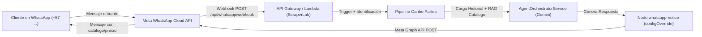

# Pipeline de WhatsApp Cloud API Multi-Empresa: Caribe Partes

Documento de arquitectura y especificación técnica para la integración de **WhatsApp Cloud API (Meta)** con el orquestador conversacional con IA y RAG de **ScraperLab**, ilustrado con el caso de uso del cliente **Caribe Partes**.

---

## 1. Visión General

El pipeline `pipeline-whatsapp-caribe-partes` orquesta la recepción de mensajes desde WhatsApp en tiempo real, la resolución de contexto e historial en DynamoDB, la consulta de catálogo en la base de conocimiento RAG, y el despacho de respuestas automatizadas a través de Meta Graph API.



---

## 2. Definición del Pipeline

- **ID del Pipeline:** `pipeline-whatsapp-caribe-partes`
- **Cliente Asociado:** `caribe-partes` (*Caribe Partes*)
- **Canal:** `whatsapp`
- **Línea Oficial:** `+57 321 966 2703`
- **Phone Number ID (Meta):** `1372470465958598`

### Definición JSON del Flujo (`ScraperLab-Pipelines`)

```json
[
  {
    "id": "whatsapp-trigger",
    "type": "TRIGGER",
    "config": {
      "channel": "whatsapp",
      "phoneNumber": "573219662703",
      "phoneNumberId": "1372470465958598",
      "botId": "caribe-partes"
    },
    "next": "orchestrator-caribe-partes"
  },
  {
    "id": "orchestrator-caribe-partes",
    "type": "AI_PROMPT",
    "config": {
      "botId": "caribe-partes",
      "service": "AgentOrchestratorService",
      "sessionPrefix": "wa_caribe-partes",
      "enableMemory": true,
      "memoryLimit": 10
    },
    "next": "whatsapp-response"
  },
  {
    "id": "whatsapp-response",
    "type": "API_REQUEST",
    "nodeRef": "whatsapp-notice",
    "configOverride": {
      "url": "https://graph.facebook.com/v21.0/1372470465958598/messages",
      "bodyTemplate": {
        "messaging_product": "whatsapp",
        "recipient_type": "individual",
        "to": "{{input.fromNumber}}",
        "type": "text",
        "text": {
          "body": "{{nodes.orchestrator-caribe-partes.reply}}",
          "preview_url": false
        }
      }
    },
    "next": null
  }
]
```

---

## 3. Jerarquía de Configuración: Global vs Particular

Para soportar múltiples empresas y sucursales en la misma plataforma sin colisiones de credenciales:

### A. Configuraciones Globales (CI/CD - GitHub Actions Secrets / `.env`)
Son las credenciales base de la infraestructura de ScraperLab:

| Variable | Descripción | Valor / Origen |
| :--- | :--- | :--- |
| `WHATSAPP_ACCESS_TOKEN` | Token Permanente de Usuario de Sistema en Meta | Generado en Meta Business Manager (Sin vencimiento) |
| `WHATSAPP_VERIFY_TOKEN` | Token para handshake de verificación del webhook | `scraperlabs_whatsapp_verify_token` |
| `WHATSAPP_PHONE_NUMBER_ID` | Identificador por defecto de la línea de ScraperLab | `1372470465958598` |
| `WHATSAPP_DEFAULT_RECIPIENT` | Teléfono de guardia para alertas de monitoreo | `573219662703` |

### B. Configuraciones Particulares (Por Bot y Pipeline en DynamoDB)
Cada cliente o sucursal define sus propios parámetros sin alterar el código ni las variables de entorno globales:

1. **En `ScraperLab-Bots` (`caribe-partes`):**
   - `channels.whatsapp.phoneNumberId`: ID del número asignado a esa sucursal/empresa (`1372470465958598`).
   - `channels.whatsapp.agentPhoneNumber`: Línea del asesor humano para transferencias/handoff (`573219662703`).
   - `branding`: Logo (`/images/caribe-partes.png`), mensajes de bienvenida y colores corporativos.
2. **En `ScraperLab-BotKnowledge`:**
   - Catálogo RAG de autopartes, llantas (Ónix Turbo, Renault Duster, Sandero, Hilux, etc.), precios y servitecas aliadas.
3. **En `ScraperLab-Pipelines` (`configOverride`):**
   - `to: "{{input.fromNumber}}"`: El destinatario se resuelve dinámicamente con el número del cliente que escribió.
   - `url`: Apunta al `phone_number_id` específico de la empresa o sucursal.

---

## 4. Memoria Contextual Persistente

Para evitar que los bots pierdan el hilo cuando un cliente tarda minutos, horas o días en contestar:

- **Almacenamiento:** Tabla DynamoDB `ScraperLab-ChatSessions`.
- **Identificador de Sesión:** `wa_{botId}_{numeroCliente}` (ej: `wa_caribe-partes_573188793159`).
- **Hidratación Automática:** `AgentOrchestratorService` recupera los últimos 10 mensajes previos y los inyecta como contexto a Gemini. Si el cliente ya indicó su modelo de carro en mensajes anteriores, el bot lo recuerda automáticamente y no vuelve a pedir la información.

---

## 5. Webhook Endpoints

| Método | Endpoint | Propósito |
| :--- | :--- | :--- |
| `GET` | `/api/whatsapp/webhook` | Handshake de verificación de Meta (`hub.mode`, `hub.verify_token`, `hub.challenge`). |
| `POST` | `/api/whatsapp/webhook` | Recepción de eventos y mensajes entrantes de Meta. Resuelve el bot por `phone_number_id`, ejecuta el pipeline y responde. |
| `POST` | `/api/whatsapp/send` | Endpoint autenticado de ScraperLab para envíos directos o pruebas. |
